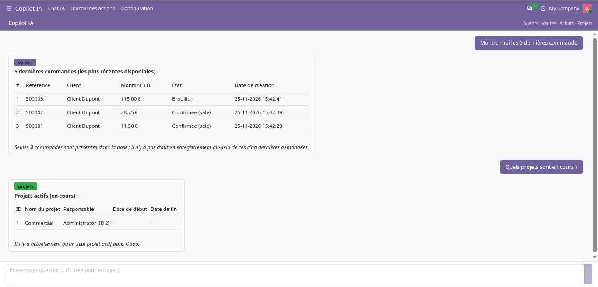
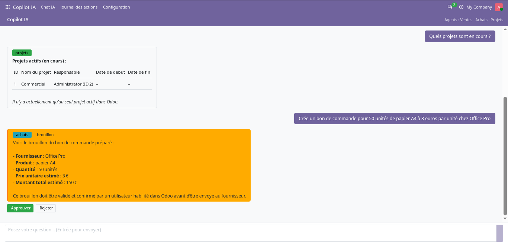
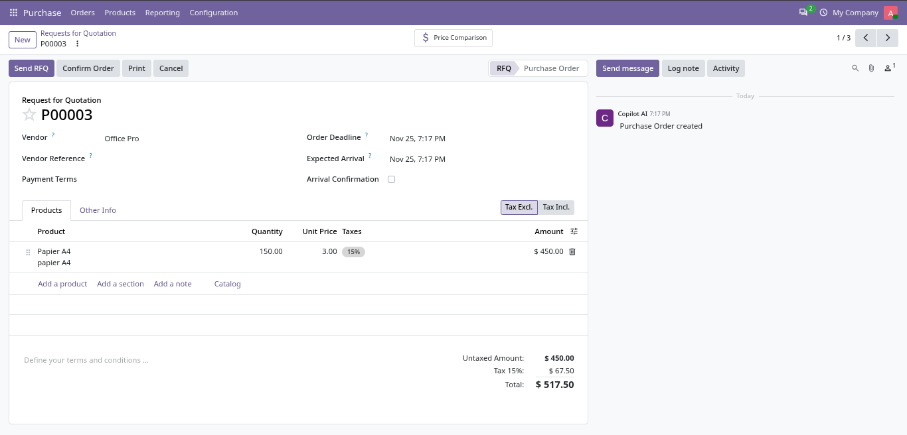

# OdooCopilot

Assistant IA multi-agents intégré à Odoo 20. Il répond aux questions sur les
ventes, achats et projets, et prépare des actions soumises à une validation
humaine avant toute écriture.

**Version** : module Odoo `20.0.2.0.0` · microservice `3.0.0`

## Démonstration

Captures réalisées avec des données de test. Les devises et montants affichés
dépendent de la configuration de l'instance Odoo.

| Commandes de vente formatées | Proposition d'achat et projets |
|---|---|
|  |  |

**Après approbation** — Odoo crée une demande de prix qui reste en brouillon,
à confirmer manuellement.



## Fonctionnalités

- Agents spécialisés pour Ventes, Achats et Projets, avec routage des questions.
- Accès aux données Odoo via JSON-2 et clé API Bearer.
- Propositions d'achat soumises à approbation ; le bon créé reste en brouillon.
- Journalisation des brouillons, approbations et rejets dans `ai.action.log`.
- RAG documentaire optionnel avec ChromaDB.

Les brouillons de tâches projet ne sont pas encore exécutés et l'agent Ventes
est en lecture seule. Les limites sont détaillées dans
[docs/troubleshooting.md](docs/troubleshooting.md).

## Démarrage rapide

Les étapes complètes, incluant la configuration Odoo et les options RAG, sont
dans le [guide d'installation](docs/setup.md).

1. Copier `.env.example` vers `.env` et renseigner `GROQ_API_KEY`,
   `ODOO_URL`, `ODOO_DB`, `ODOO_API_KEY` et `SERVICE_API_KEY`.
2. Créer un environnement et installer les dépendances :

   ```bash
   cd ai_service
   python -m venv .venv
   source .venv/bin/activate
   pip install -r requirements.txt
   ```

3. Démarrer le service :

   ```bash
   uvicorn main:app --reload --port 8001
   ```

4. Installer le module `odoo_copilot`, puis configurer l'URL et la clé du
   microservice dans **Copilot IA → Configuration**.

Vérifier le service avec `curl http://localhost:8001/health`. La documentation
interactive est disponible sur <http://localhost:8001/docs>.

## Utilisation

Dans Odoo, ouvrir **Copilot IA → Chat IA**. Exemples :

```text
Montre-moi les 5 dernières commandes de vente
Quels sont les bons de commande en attente ?
Quels projets sont en cours ?
Crée un bon de commande pour 50 unités de papier A4 chez Office Pro
```

Pour une demande d'achat, vérifier le brouillon proposé, puis l'approuver ou le
rejeter dans le chat. Une approbation crée une demande de prix en brouillon dans
Odoo ; la confirmation auprès du fournisseur reste manuelle. Les commandes API
et leur format sont décrits dans [docs/api.md](docs/api.md).

## Architecture

Le module Odoo transmet les requêtes au microservice FastAPI. LangGraph route
chaque question vers un agent, qui utilise uniquement les outils autorisés.
L'accès aux données Odoo passe par JSON-2 ; le RAG peut enrichir les réponses
avec des documents indexés.

Voir [docs/architecture.md](docs/architecture.md) pour les schémas, le flux
d'approbation et les composants.

## Documentation

| Guide | Contenu |
|---|---|
| [Installation](docs/setup.md) | Environnement, API Odoo, module Odoo et RAG |
| [API](docs/api.md) | Routes, exemples de requêtes et réponses |
| [Architecture](docs/architecture.md) | Agents, flux, journal et RAG |
| [Sécurité](docs/security.md) | Authentification, droits et recommandations de déploiement |
| [Tests manuels](docs/testing.md) | Scénarios de vérification fonctionnelle |
| [Dépannage et limites](docs/troubleshooting.md) | Erreurs fréquentes, limites et pistes d'évolution |
