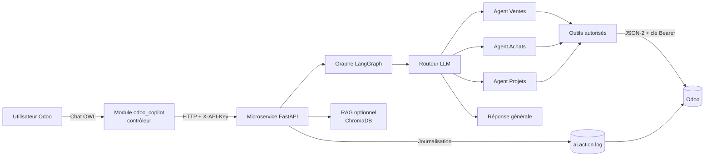
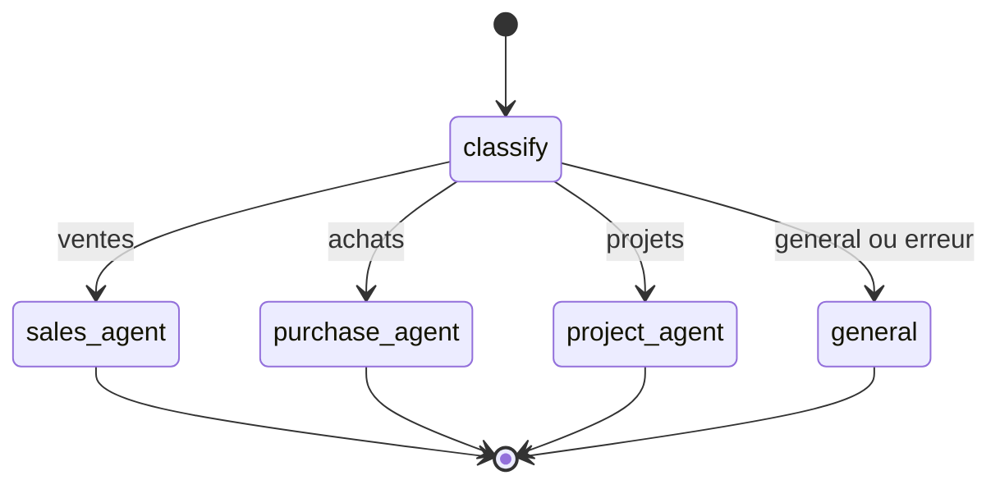
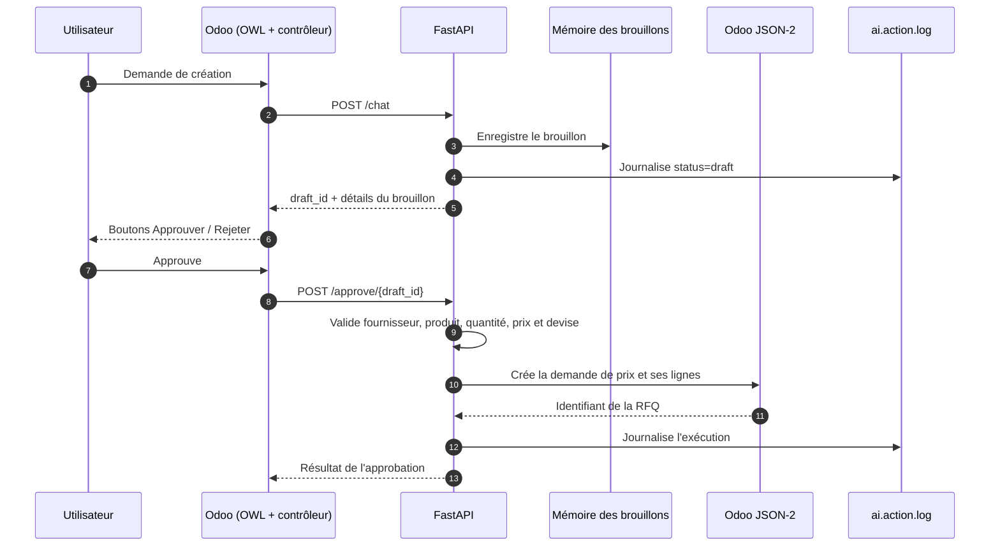
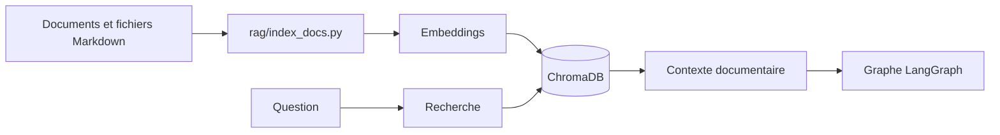

# Architecture OdooCopilot

Vue d'ensemble des composants, du routage des agents et du circuit
d'approbation. Pour installer et configurer le projet, consultez
[docs/setup.md](setup.md).

## Vue d'ensemble

Le navigateur n'appelle pas directement le microservice. Le contrôleur Odoo
relaye les requêtes à l'aide de la clé stockée dans `ai.config`. Le microservice
interroge Odoo avec l'API JSON-2 et la clé Bearer de l'utilisateur technique.

## Composants

| Composant | Emplacement | Responsabilité |
|---|---|---|
| Panneau de chat OWL | `addons/odoo_copilot/static/src/` | Saisie, affichage, approbation et rejet |
| Contrôleur Odoo | `addons/odoo_copilot/controllers/copilot_controller.py` | Proxy authentifié vers le service |
| Configuration | `addons/odoo_copilot/models/ai_config.py` | URL et clé du service |
| Journal | `addons/odoo_copilot/models/ai_action_log.py` | Traçabilité des actions et réponses |
| API | `ai_service/main.py` | Routes FastAPI, brouillons et exécution après approbation |
| Graphe | `ai_service/agents/router.py` | Classification et routage |
| Agents | `ai_service/agents/` | Instructions, outils et brouillons métier |
| Client Odoo | `ai_service/tools/odoo_client.py` | Appels JSON-2 `search_read`, `create` et `write` |
| Filtre | `ai_service/tools/prompt_filter.py` | Filtrage d'entrées |
| RAG | `ai_service/rag/` | Indexation et recherche documentaire |

## Routage

Les agents métier n'obtiennent qu'une liste blanche d'outils liée à leur
domaine. Ventes et Projets lisent les données ; Achats peut également proposer
un bon d'achat. Une proposition n'effectue aucune écriture tant qu'elle n'a pas
été approuvée.

## Cycle d'une demande d'achat

La RFQ créée reste en brouillon : la confirmation auprès du fournisseur est une
action Odoo distincte. Un échec de validation ou d'exécution est renvoyé au
client et laisse le brouillon réessayable après correction. La création utilise
l'identifiant du brouillon comme référence d'origine pour éviter une création
en double lors d'une nouvelle tentative.

Les brouillons de tâches projet sont approuvés et journalisés, mais leur
exécution métier n'est pas encore implémentée. Les brouillons sont conservés en
mémoire et disparaissent au redémarrage du service.

## RAG

Le RAG est facultatif. `chroma-onnx` est le backend léger par défaut ;
`sentence-transformers` est une option CPU, plus lourde et généralement
meilleure pour le français. Les vecteurs ne sont pas interchangeables entre
backends : réindexez après un changement.

## Journal et configuration Odoo

`ai.config` stocke l'URL du microservice et la clé partagée ; une configuration
active est utilisée. `ai.action.log` conserve notamment la question, l'agent,
le statut, le payload proposé, la réponse, l'utilisateur et la date. Les
utilisateurs internes peuvent lire et créer les journaux ; l'administration
peut les modifier ou les supprimer.

Pour les détails des contrôles d'accès, consultez [docs/security.md](security.md).
