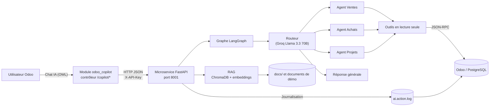
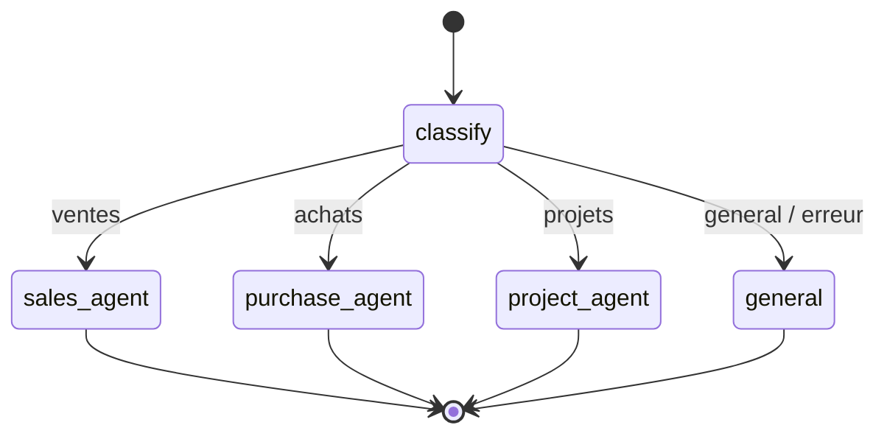
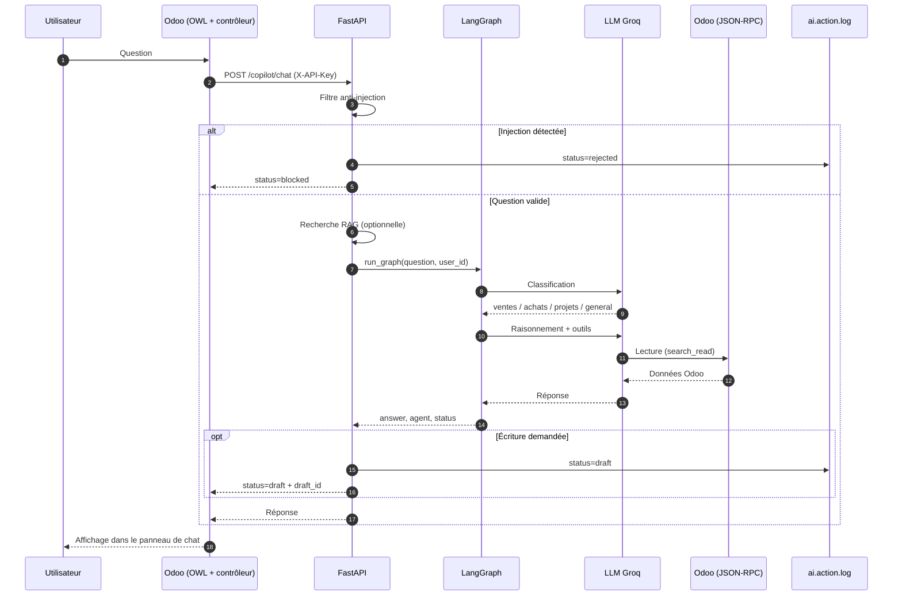
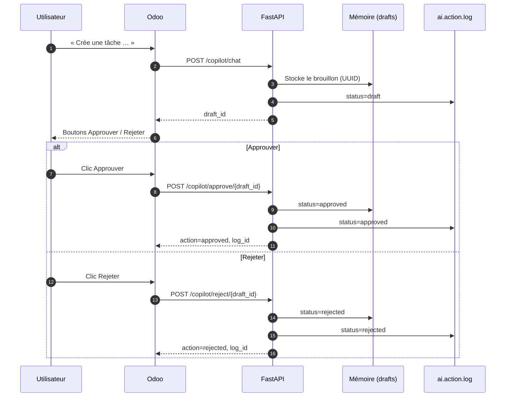
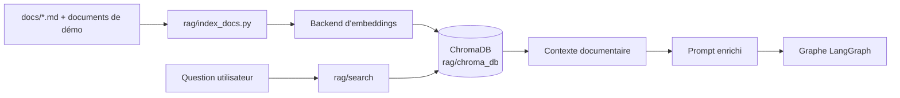

# Architecture OdooCopilot

Document de référence : vue d'ensemble, flux d'agents, circuit de validation et
mesures de sécurité. Le guide d'installation et les scénarios de vérification
restent dans le [README](../README.md).

---

## 1. Vue d'ensemble

**Points clés**

- Le navigateur ne parle jamais directement au microservice : le contrôleur Odoo
  relaie les appels avec la clé API stockée dans `ai.config`.
- Le microservice ne parle à Odoo que via JSON-RPC, avec un utilisateur technique.
- Toute écriture métier passe par un **brouillon** validé par un humain.
- Le RAG est optionnel : le service démarre et répond sans lui.

---

## 2. Composants

| Composant | Fichier / dossier | Responsabilité |
|---|---|---|
| Panneau de chat OWL | `addons/odoo_copilot/static/src/` | Saisie, affichage des réponses, boutons Approuver / Rejeter |
| Contrôleur Odoo | `addons/odoo_copilot/controllers/copilot_controller.py` | Proxy `/copilot/chat`, `/copilot/approve`, `/copilot/reject` |
| Configuration | `addons/odoo_copilot/models/ai_config.py` | URL du microservice + clé API, une configuration active |
| Journal | `addons/odoo_copilot/models/ai_action_log.py` | Traçabilité des brouillons, approbations et rejets |
| API FastAPI | `ai_service/main.py` | Authentification, endpoints `/chat`, `/stream`, `/drafts`, `/rag/*`, journalisation |
| Graphe LangGraph | `ai_service/agents/router.py` | Classification et routage vers l'agent compétent |
| Exécution des agents | `ai_service/agents/tool_agent.py` | `create_agent` (LangChain 1.x), extraction de la réponse et des brouillons |
| Agents | `ai_service/agents/{sales,purchase,project}_agent.py` | Outils métier et détection des brouillons |
| Client Odoo | `ai_service/tools/odoo_client.py` | Authentification JSON-RPC, `search_read`, `create`, `write` |
| Filtre anti-injection | `ai_service/tools/prompt_filter.py` | 15 motifs, troncature à 2000 caractères, suppression HTML |
| RAG | `ai_service/rag/` | Indexation et recherche documentaire (backend ONNX par défaut) |

---

## 3. Graphe LangGraph

État partagé (`AgentState`) :

| Champ | Type | Rôle |
|---|---|---|
| `question` | `str` | Question nettoyée (contexte RAG éventuellement préfixé) |
| `user_id` | `int` | Utilisateur Odoo à l'origine de la demande |
| `agent` | `str` | `ventes`, `achats`, `projets` ou `routeur` |
| `answer` | `str` | Réponse finale |
| `status` | `str` | `ok`, `draft`, `error` ou `blocked` |
| `draft_payload` | `dict \| None` | Payload JSON du brouillon, si une écriture est proposée |

La classification est un appel LLM à température 0. Si la réponse n'est pas une
catégorie connue, ou si l'appel échoue, le graphe bascule sur `general`.

---

## 4. Séquence d'une question

---

## 5. Brouillon et validation humaine

> **Limite actuelle** : l'approbation journalise l'action mais n'écrit pas encore
> dans les modèles métier Odoo. Les brouillons sont stockés en mémoire et sont
> perdus au redémarrage du microservice.

---

## 6. Flux RAG

Deux backends sont disponibles via `RAG_EMBEDDING_BACKEND` :

| Valeur | Modèle | Dépendances | Remarque |
|---|---|---|---|
| `chroma-onnx` (défaut) | ONNX MiniLM (384 dim.) | `chromadb`, `onnxruntime` | Aucun PyTorch/CUDA ; modèle téléchargé au premier usage |
| `sentence-transformers` | `paraphrase-multilingual-MiniLM-L12-v2` | `sentence-transformers`, PyTorch **CPU** | Meilleure qualité en français, installation plus lourde |

Les vecteurs des deux backends ne sont pas compatibles : supprimer
`rag/chroma_db/` et réindexer après un changement.

---

## 7. Modèle de données Odoo

### `ai.config`

| Champ | Type | Description |
|---|---|---|
| `name` | Char | Nom de la configuration |
| `service_url` | Char | URL du microservice (défaut `http://localhost:8001`) |
| `service_api_key` | Char | Clé partagée avec le microservice (`SERVICE_API_KEY`) |
| `active` | Boolean | Seule la première configuration active est utilisée |

### `ai.action.log`

| Champ | Type | Description |
|---|---|---|
| `name` | Char | Résumé court |
| `question` | Text | Question d'origine |
| `agent` | Selection | `ventes`, `achats`, `projets`, `routeur` |
| `status` | Selection | `draft`, `approved`, `rejected`, `executed` |
| `draft_payload` | Text | Payload JSON de l'action proposée |
| `response` | Text | Réponse complète de l'agent |
| `user_id` | Many2one `res.users` | Utilisateur à l'origine de la demande |
| `create_date` | Datetime | Horodatage |

Droits : les utilisateurs internes lisent et créent le journal ; seul le groupe
`base.group_system` peut modifier et supprimer. La configuration est en lecture
seule pour les utilisateurs, modifiable par les administrateurs.

---

## 8. Défense en profondeur

| Couche | Mesure |
|---|---|
| Réseau | Le microservice écoute en local (`localhost:8001`) ; le navigateur passe par Odoo |
| Authentification | Header `X-API-Key` sur `/chat`, `/approve`, `/reject`, `/drafts`, `/rag/*` |
| Session Odoo | `auth="user"` + `csrf=True` sur les routes du contrôleur |
| Filtrage d'entrée | 15 motifs d'injection, troncature, suppression des balises HTML |
| Liste blanche | Chaque agent ne reçoit que ses outils déclarés |
| Lecture seule | Aucun outil d'écriture métier ; les propositions renvoient un payload |
| Validation humaine | Approbation explicite avant toute exécution future |
| Journalisation | Chaque brouillon, approbation ou rejet est tracé dans `ai.action.log` |
| Secrets | `.env` ignoré par Git ; `.env.example` sans valeur sensible |

> Le CORS est volontairement permissif pour le développement local. En production,
> restreindre `allow_origins` et servir le microservice derrière un reverse proxy.

---

## 9. Variables d'environnement

| Variable | Défaut | Usage |
|---|---|---|
| `GROQ_API_KEY` | — | Clé API Groq (LLM) |
| `ODOO_URL` | `http://localhost:8069` | URL de l'instance Odoo |
| `ODOO_DB` | `odoo` | Nom de la base PostgreSQL |
| `ODOO_USER` | `copilot_ai` | Login de l'utilisateur technique |
| `ODOO_API_KEY` | — | Clé API de l'utilisateur technique |
| `SERVICE_API_KEY` | — | Clé partagée Odoo ↔ microservice (vide = auth désactivée en dev) |
| `CHROMA_PATH` | `./rag/chroma_db` | Répertoire de la base vectorielle |
| `RAG_EMBEDDING_BACKEND` | `chroma-onnx` | `chroma-onnx` ou `sentence-transformers` |

---

## 10. Références

- [README — installation, utilisation, scénarios](../README.md)
- [AGENT.md — règles du projet](../AGENT.md)
- [CHANGELOG.md — historique par phase](../CHANGELOG.md)
